# The Hitchhiker's Guide to Earth

### 산책 경로 공유 서비스

주변 산책 경로를 찾고, 경로를 따라가며 발견한 장소와 후기를 공유하는 웹 서비스입니다. 
채팅방에서 함께할 사람을 만나고, 커뮤니티와 중고 거래 상점에서 교류할 수 있습니다.

### 서비스 접속

[decfour.dev](https://decfour.dev)

| 프로젝트 | 내용 |
|---|---|
| 개발 인원 | 개인 프로젝트 · 1명 |
| 개발 기간 | 2026.07 ~ 2026.10 |
| 테스트 계정 | ID: `test` / PASSWORD: `1234` |

## 문서

| 문서 | 확인할 내용 |
|---|---|
| [API 명세](doc/API_SPEC_PUBLIC.md) | HTTP·STOMP 경로, 요청·응답, 인증·권한, 페이징 |
| [산책·채팅 ERD](doc/erd/course.md) | 경로·별점·후기·핀·채팅 데이터 관계 |
| [기술적 판단과 개선 기록](doc/TECHNICAL_DECISIONS.md) | 성능 측정, 채팅 설계, 동시성·조회 개선 |
| [테스트 안내](doc/TESTING.md) | 테스트 범위, 실행 명령, 테스트 DB 준비 |

## 사용 기술

### Backend · 서버와 인증

### Frontend · 화면 구성

### Database · 데이터 저장

### Communication · 실시간 채팅과 지도

### Infrastructure & Build · 운영과 빌드

### Test · 검증

## 시스템 아키텍처

단일 Spring Boot 애플리케이션에서 화면·API·실시간 채팅을 처리합니다. 

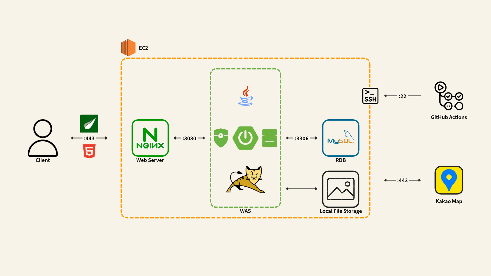

## 주요 기능과 화면

### 산책 경로 탐색과 공유

현재 위치나 직접 지정한 위치를 기준으로 **출발점이 반경 1km 안에 있는 산책 경로**를 탐색합니다. 
목록에서 경로를 선택하면 지도에서 이동 경로를 확인할 수 있습니다.

직접 경로를 등록하거나, 평균 별점과 평가 수를 기준으로 선정한 인기 경로를 살펴볼 수 있습니다.

  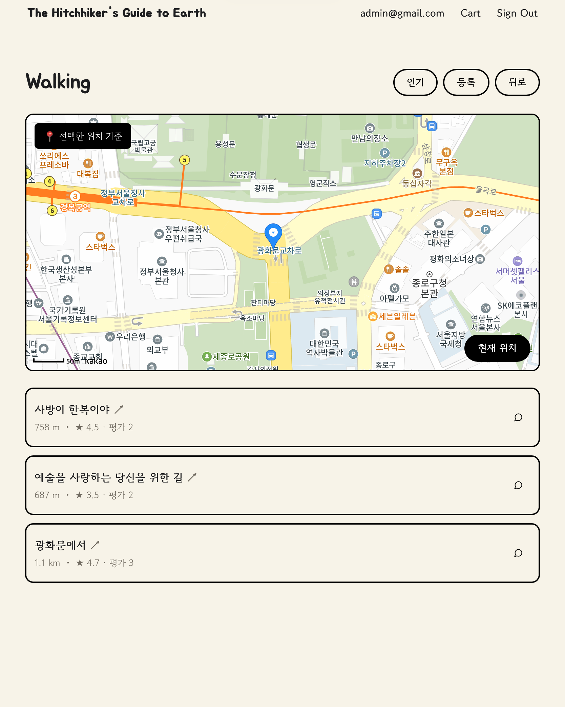
  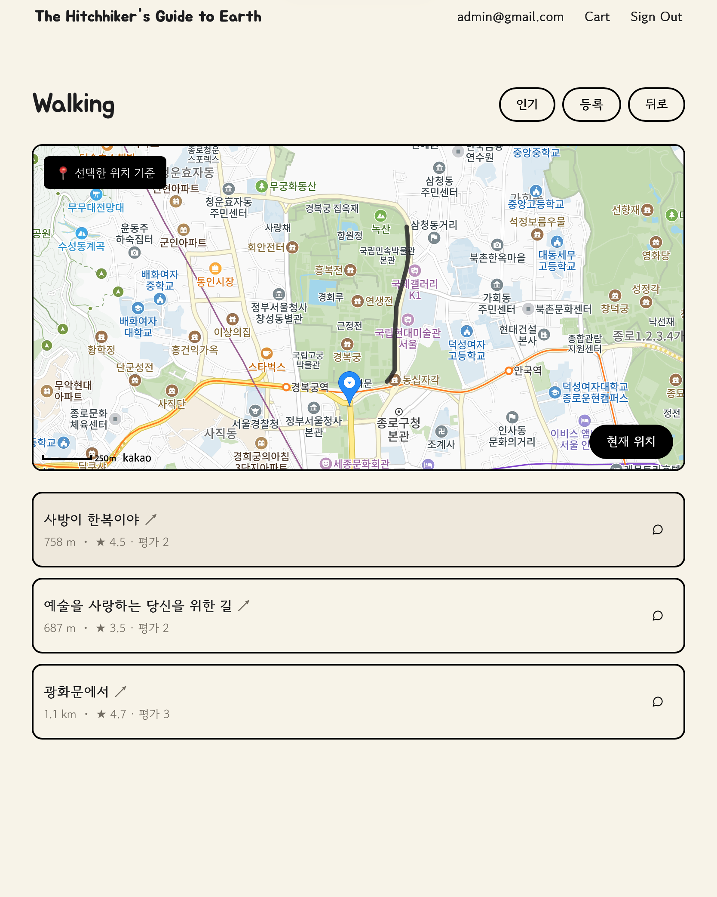

상세 화면에서는 경로 설명과 태그, 후기를 확인할 수 있습니다. 
지도에서 핀을 눌러 다른 이용자의 메모를 읽고, **경로에서 30m 이내에 발견한 장소를 핀과 메모로 남길 수 있습니다.** 

  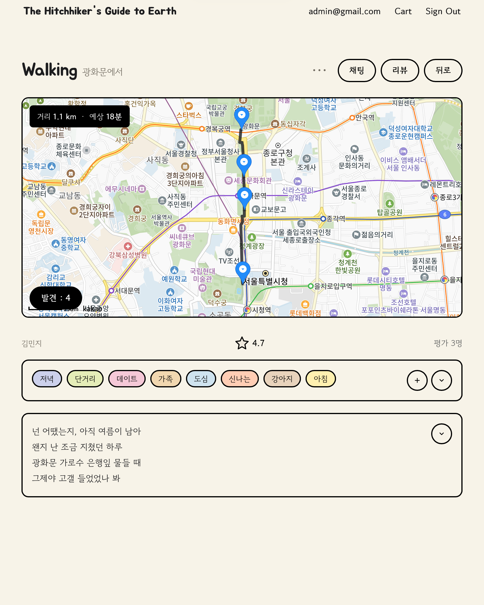
  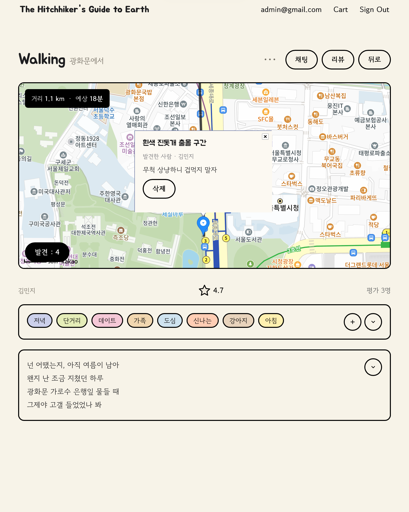

태그 추가 버튼으로 경로의 특징에 맞는 태그를 남기고, 별 모양 아이콘을 눌러 **1~5점으로 평가**할 수 있습니다.

  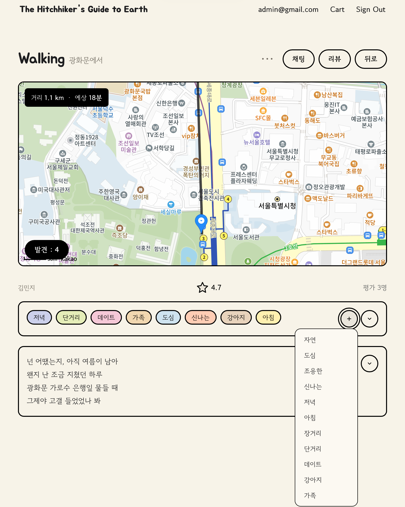
  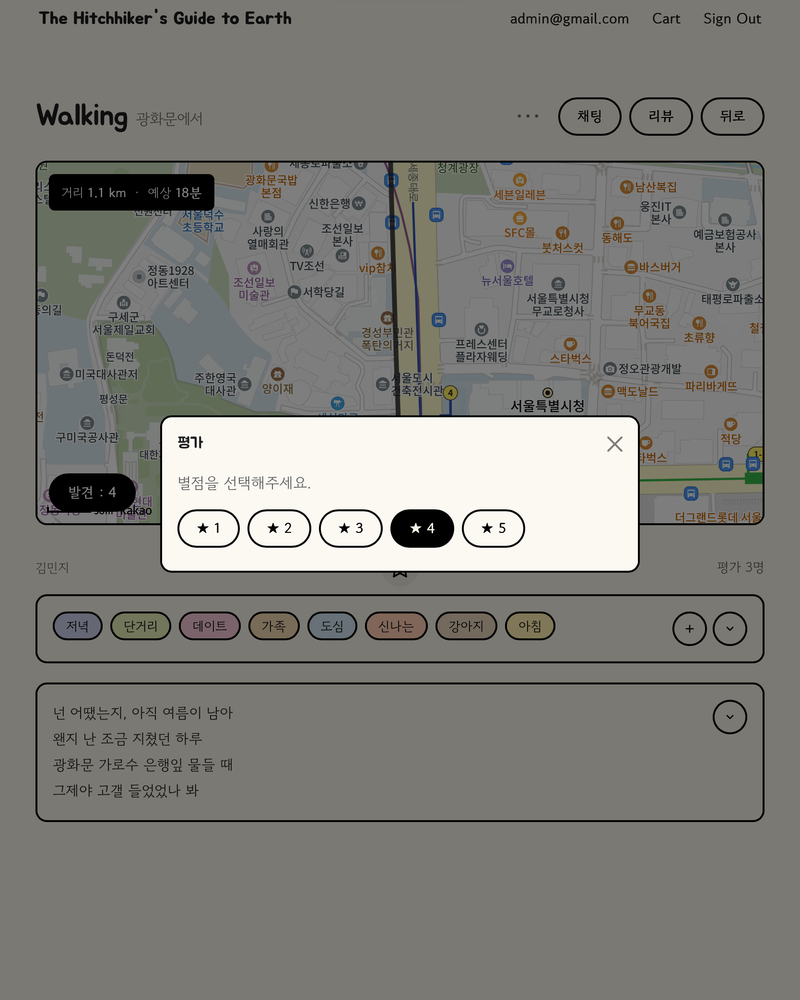

### 함께 걷기

산책 경로별 채팅방에서 함께 걸을 이용자를 만나고, 실시간 메시지를 주고받을 수 있습니다. 
이전 대화를 불러올 수 있으며, **방장을 포함해 최대 5명**이 참여합니다. 방장이 나가면 채팅방이 종료됩니다.

  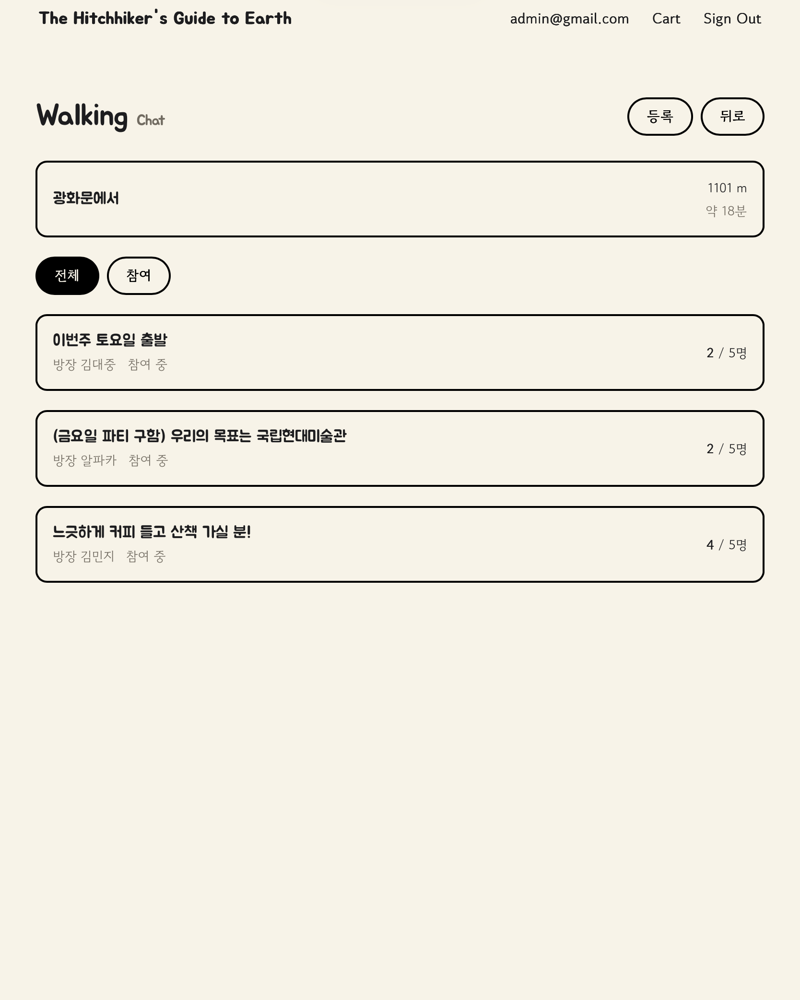
  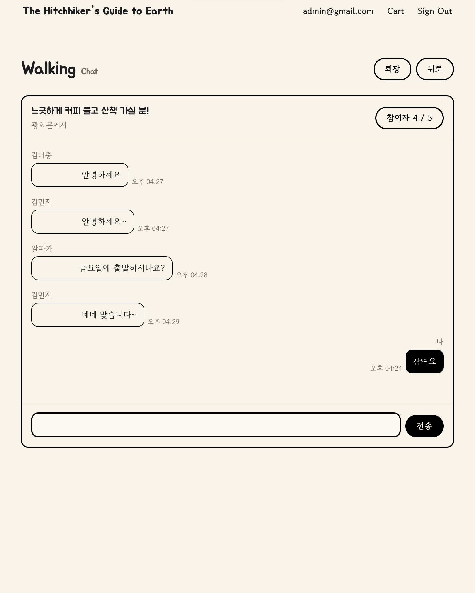

### 커뮤니티 & 중고 장터

게시글과 공지사항을 확인하며, **추천 20개 이상인 게시글**은 HIT 목록에서 볼 수 있습니다.
중고 상품을 이미지와 함께 등록하고 상세 설명과 후기를 확인할 수 있습니다. 

  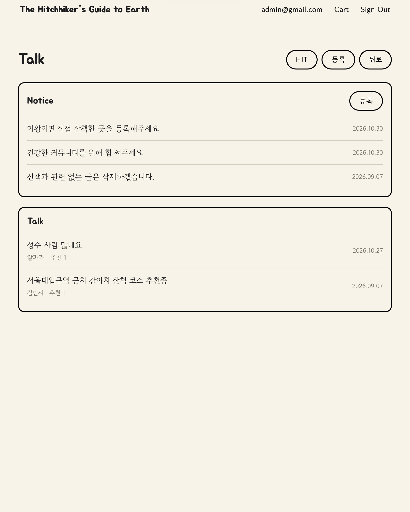
  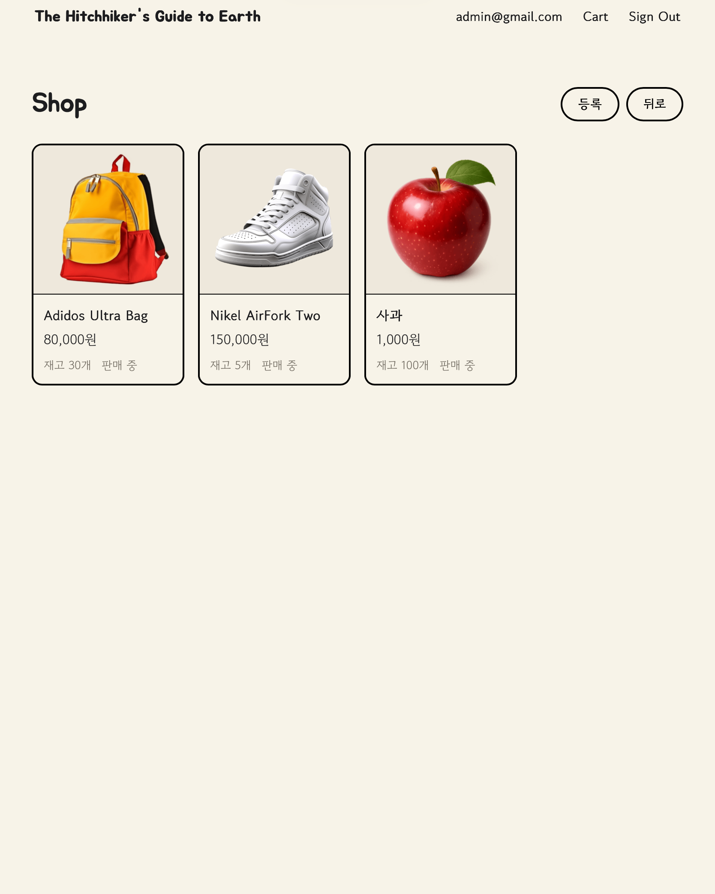

### 마이페이지

회원가입·로그인 후 산책 경로 등록, 후기 작성, 채팅 참여 등의 활동을 이용할 수 있습니다 
마이페이지에서는 **내 산책 경로·발견 장소 메모·참여 채팅방·후기·게시글·댓글·상품·주문 내역**을 모아 볼 수 있습니다.

  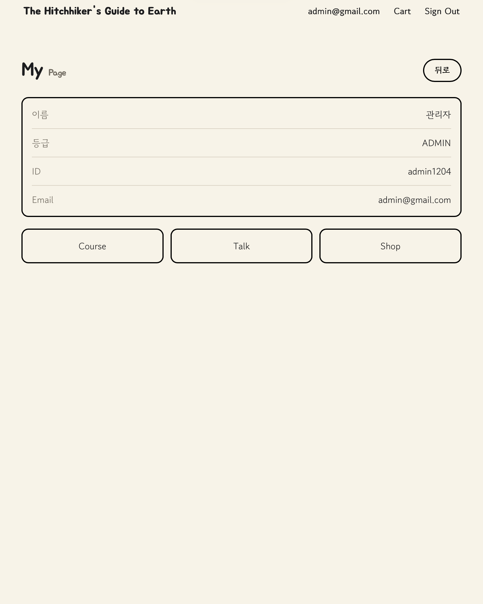
  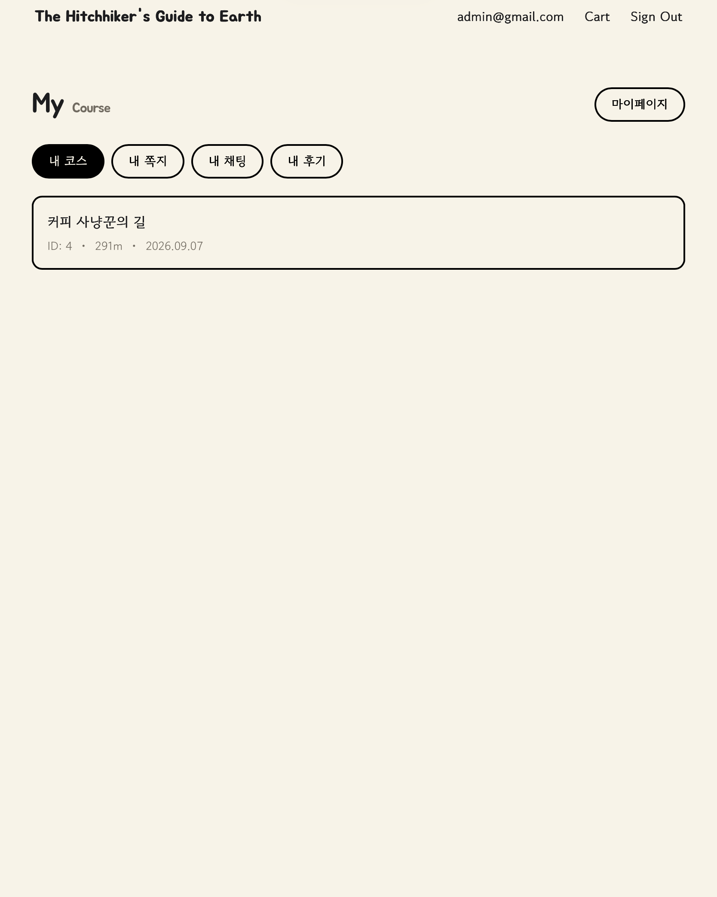

