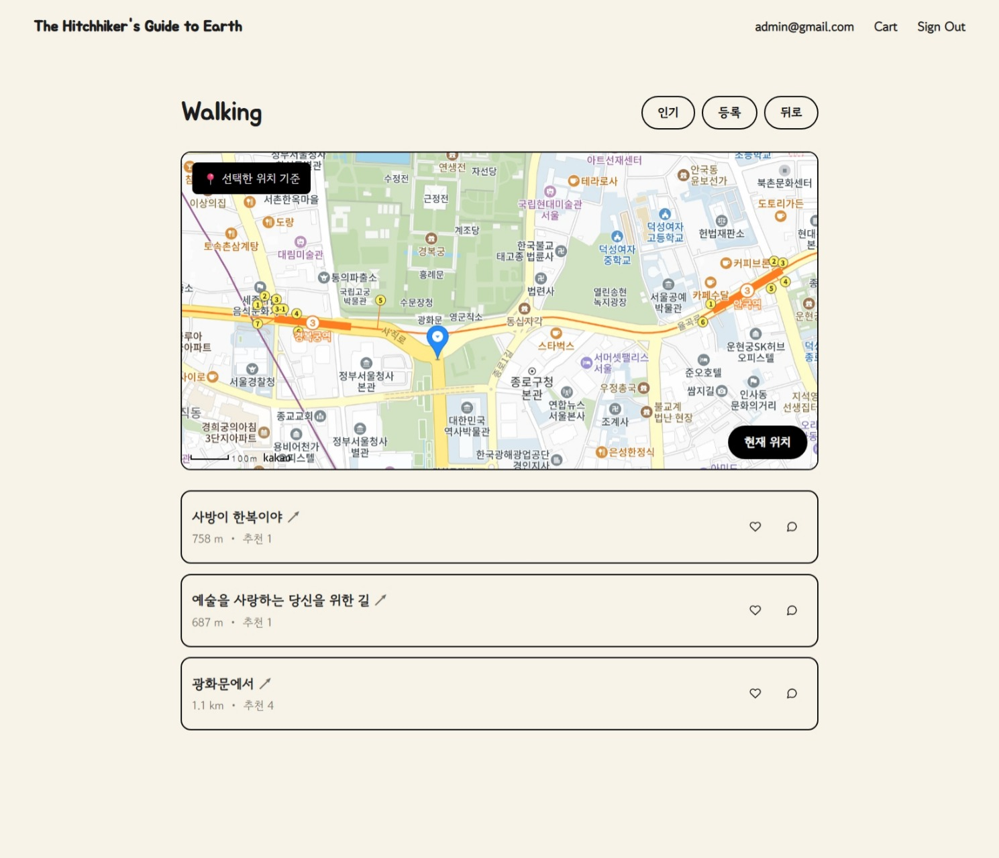
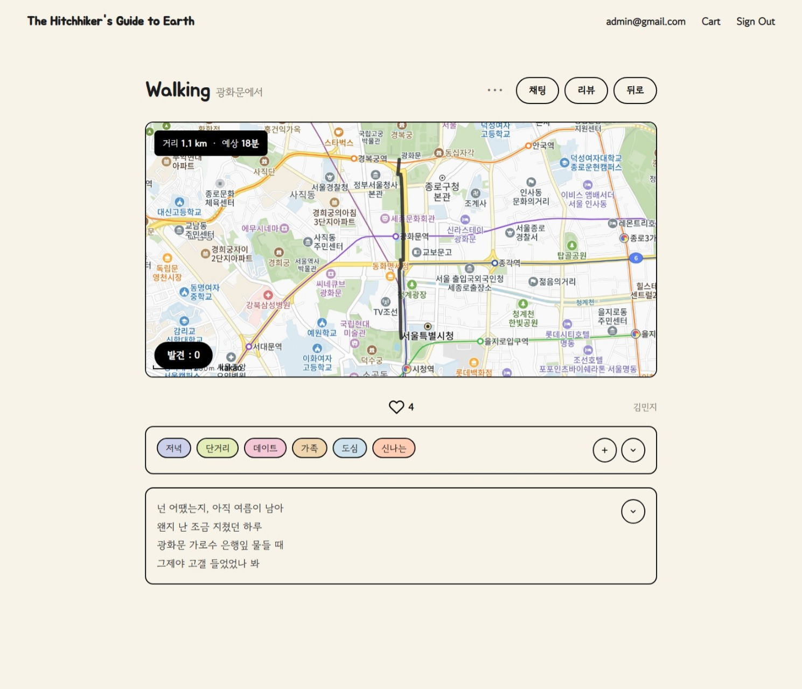
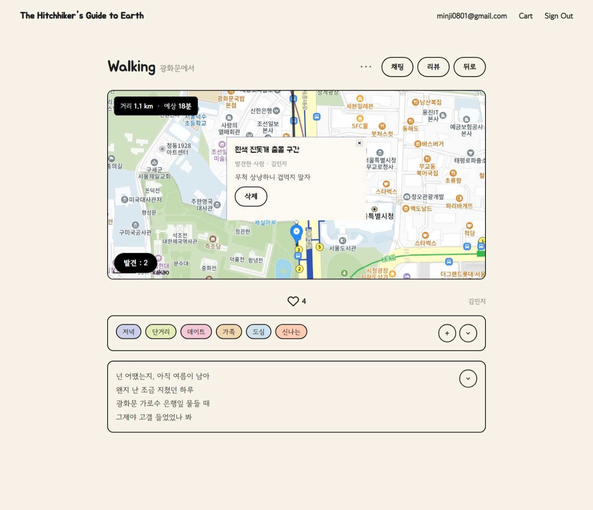
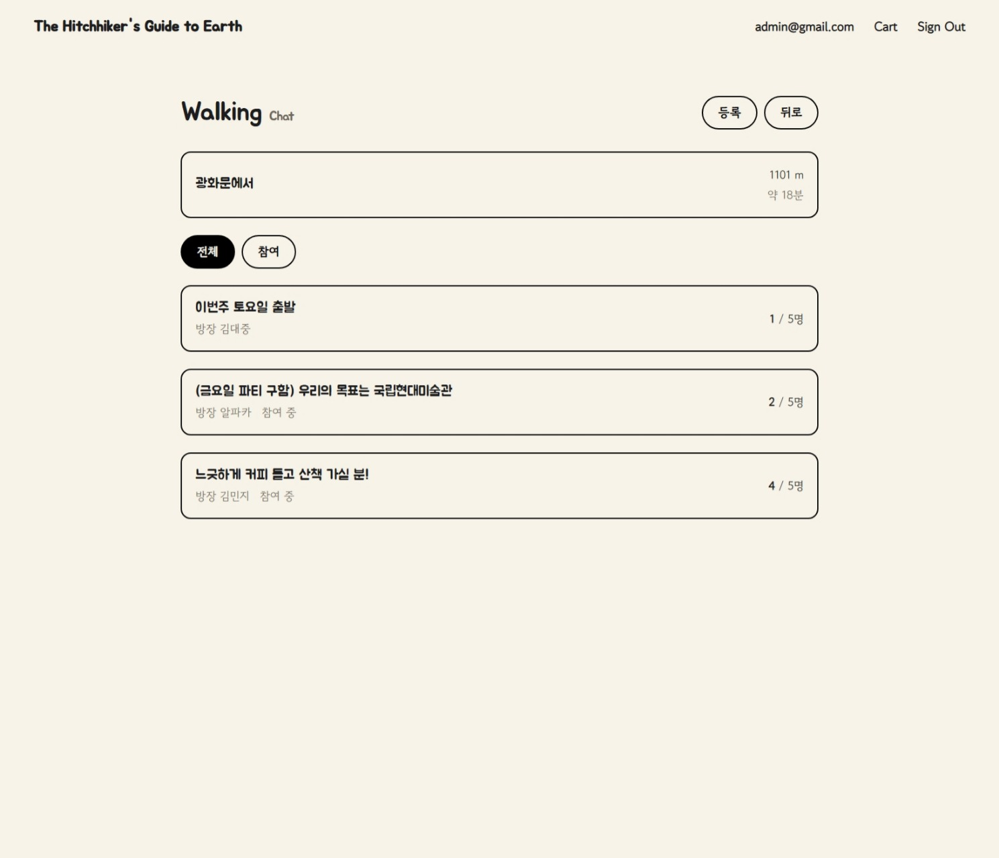
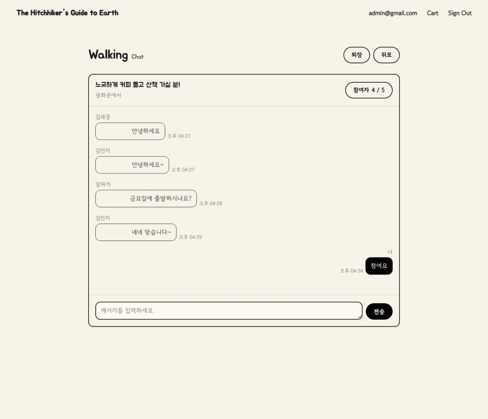
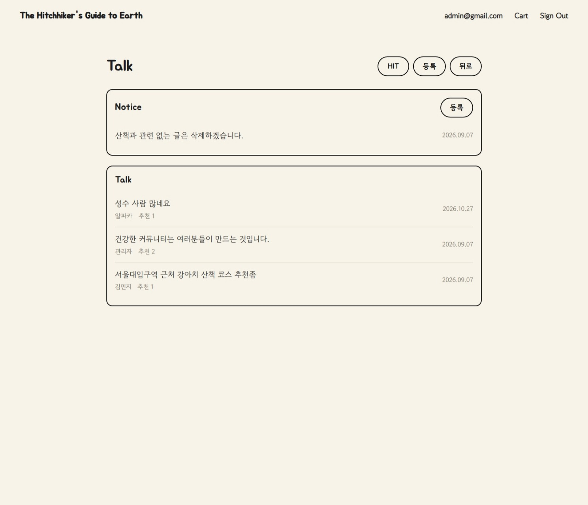
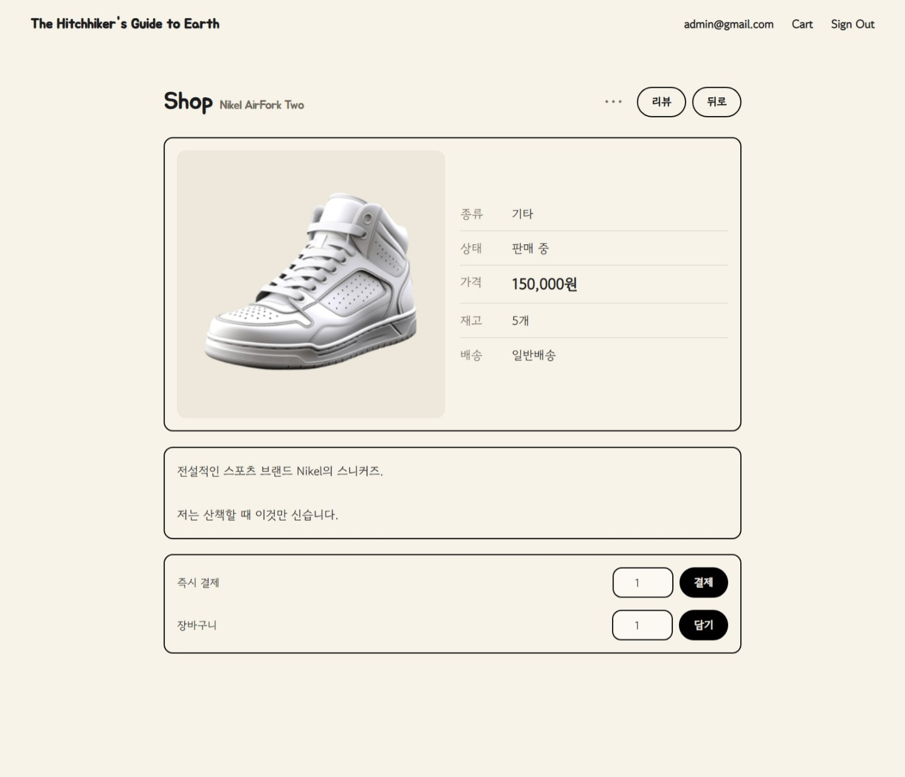

# The Hitchhiker's Guide to Earth

사용자가 원하는 위치를 기준으로 주변 산책 경로를 탐색하고 공유할 수 있는 웹 서비스입니다.

실시간 채팅을 통한 함께 걷기, 커뮤니티, 중고 거래 기능을 제공하여 사용자 간 소통을 지원합니다.

## 🔗 접속 주소

**https://decfour.dev**

**테스트 계정**
- ID: `test`
- PASSWORD: `1234`

---

## 🚀 주요 기능

- **사용자 인증:** JWT 및 Spring Security 기반 로그인 및 인증
- **산책 경로 공유:** 경로 등록, 수정, 추천 및 위치 기반 주변 경로 탐색
- **산책 경로 발견:** 발견한 장소나 요소를 메모, 공유
- **함께 걷기:** 산책 경로별 채팅방 생성 및 WebSocket / STOMP 기반 실시간 채팅
- **상점:** 사용자 간 중고 거래, 상품 관리 및 주문 기능
- **커뮤니티:** 게시글과 댓글을 통한 사용자 간 소통
- **마이페이지:** 사용자 정보 및 활동 관리
- **공지사항:** 공지사항 조회

---

## 🛠️ 기술 스택

### Backend


### Database


### Frontend


### Infra & Build


### Communication & API


---

## 🔧 Troubleshooting

### 1. 주변 코스 조회 성능 개선

**문제**
- 코스 데이터 증가에 따라 주변 산책 경로 조회 성능 저하
- 대량 데이터 및 동시 요청 환경에서 응답 지연 발생

**원인 분석**
- SQL 실행 계획을 통해 조회 과정에서 불필요하게 많은 데이터가 탐색되는 문제 확인
- 위치 기반 조회 조건에 대한 인덱스 활용 및 검색 범위 검토

**해결**
- `start_lat`, `start_lng` 컬럼에 B-Tree 인덱스 적용
- Bounding Box를 활용하여 주변 경로의 검색 범위를 제한
- 실행 계획을 비교하여 인덱스 적용 효과 검증

**결과**

| 측정 항목 | 개선 전 | 개선 후 |
| --- | ---: | ---: |
| P95 응답 시간 | 15.09초 | 98.6ms |
| 예상 탐색 행 | 9,792개 | 675개 |

- P95 응답 시간 약 **99.3% 감소**
- 약 1만 건의 코스 데이터를 활용한 부하 테스트 수행
- 최대 500명의 가상 사용자 환경에서 테스트 진행

### 2. 동시 주문 재고 정합성

**문제**
- 여러 사용자가 동시에 동일 상품을 주문할 경우 재고 차감 과정에서 동시성 문제 발생
- 동일한 재고를 여러 트랜잭션이 조회하여 초과 판매가 발생할 가능성 확인

**원인 분석**
- 재고 조회와 차감 사이에 다른 트랜잭션이 개입할 수 있는 경쟁 상태 확인
- 일반적인 트랜잭션 처리만으로는 동시 요청 시 데이터 정합성을 보장하기 어려운 상황 분석

**해결**
- 재고 조회 및 차감 과정에 비관적 락(Pessimistic Lock) 적용
- 동일 상품의 재고 변경 작업이 충돌하지 않도록 트랜잭션 처리

**결과**
- 100명의 사용자가 동시에 주문하는 상황을 가정한 테스트 수행
- 동시 주문 환경에서 재고 정합성 유지 확인

### 3. JPA N+1 문제 해결

**문제**
- 댓글 목록 조회 시 작성자 연관 엔티티를 개별 조회하면서 추가 SQL 쿼리 발생

**원인 분석**
- JPA 연관관계에 따른 엔티티 조회 과정 확인
- 댓글 목록 조회 이후 작성자 정보에 접근하면서 추가 쿼리가 반복적으로 실행되는 현상 확인

**해결**
- Fetch Join을 적용하여 댓글과 작성자 정보를 함께 조회
- 연관 엔티티에 대한 불필요한 개별 조회 제거

**결과**
- 댓글과 작성자 정보를 한 번의 조회 쿼리로 가져오도록 개선
- N+1 문제로 발생하던 불필요한 추가 SQL 쿼리 제거

---

## 🖥️ 주요 화면

### 1. 산책 경로 조회

현재 위치 또는 사용자가 지정한 위치를 기준으로 주변 산책 경로를 조회할 수 있습니다.



### 2. 산책 경로 상세

선택한 산책 경로의 상세 정보를 확인하고 추천 및 태그 기능을 사용할 수 있습니다.



### 3. 산책 경로 발견

선택한 산책 경로 근처에 발견한 요소들을 메모할 수 있습니다.



### 4. 함께 걷기 조회

등록된 산책 경로에 채팅방을 생성하고 함께 걸을 사용자를 모집할 수 있습니다.



### 5. 함께 걷기 상세

WebSocket / STOMP 기반 실시간 채팅을 통해 다른 사용자와 소통할 수 있습니다.



### 6. 커뮤니티

게시글과 댓글을 통해 사용자 간 정보를 공유하고 소통할 수 있습니다.



### 7. 상점

상품을 등록하고 조회하여 사용자 간 중고 거래를 진행할 수 있습니다.



---

## 📂 프로젝트 구조

```text
src/main
├── java/com/kdj/commerce
│   ├── config
│   ├── domain
│   │   ├── cart
│   │   ├── chat
│   │   ├── community
│   │   ├── item
│   │   ├── member
│   │   ├── notice
│   │   ├── purchase
│   │   ├── review
│   │   └── walk
│   ├── exception
│   ├── service
│   └── web
│       ├── argumentresolver
│       ├── controller
│       ├── dto
│       │   ├── chat
│       │   ├── community
│       │   ├── item
│       │   ├── member
│       │   ├── notice
│       │   ├── purchase
│       │   ├── review
│       │   └── walk
│       ├── file
│       ├── interceptor
│       ├── security
│       └── session
└── resources
    ├── static
    │   └── css
    └── templates
        ├── cart
        ├── chat
        ├── common
        ├── community
        ├── error
        ├── member
        ├── notice
        ├── purchase
        ├── review
        ├── shop
        └── walk
```