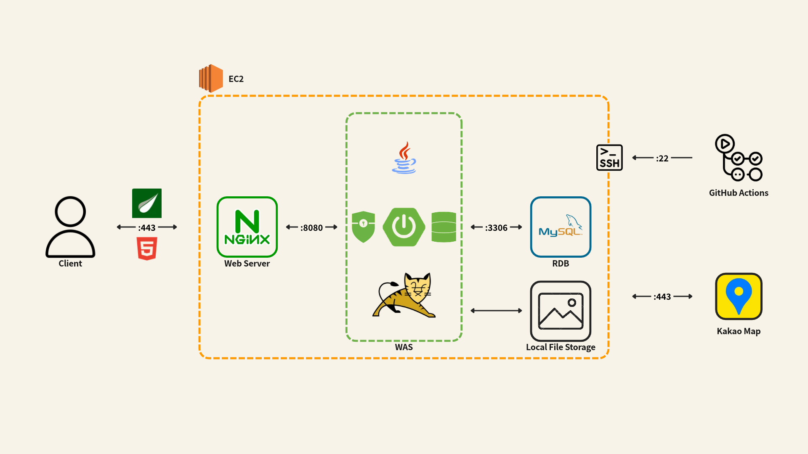
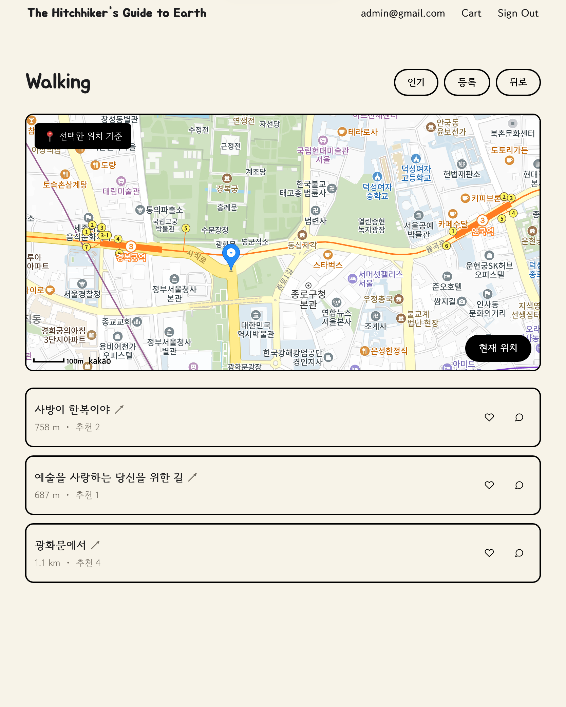
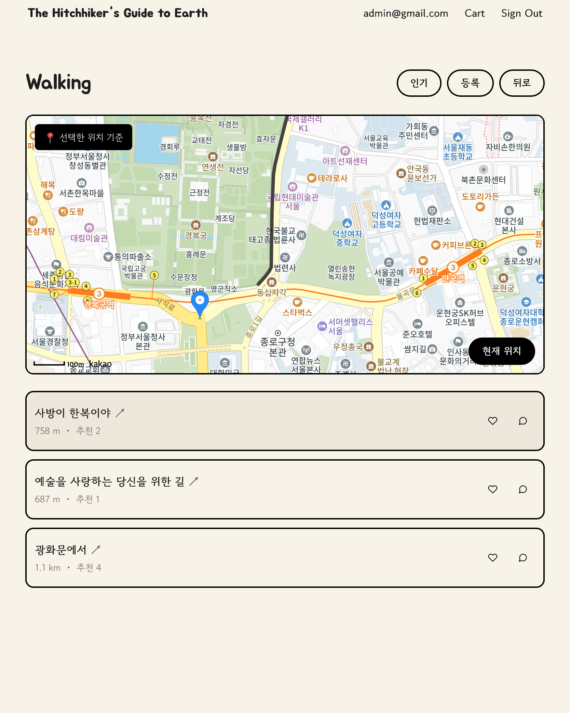
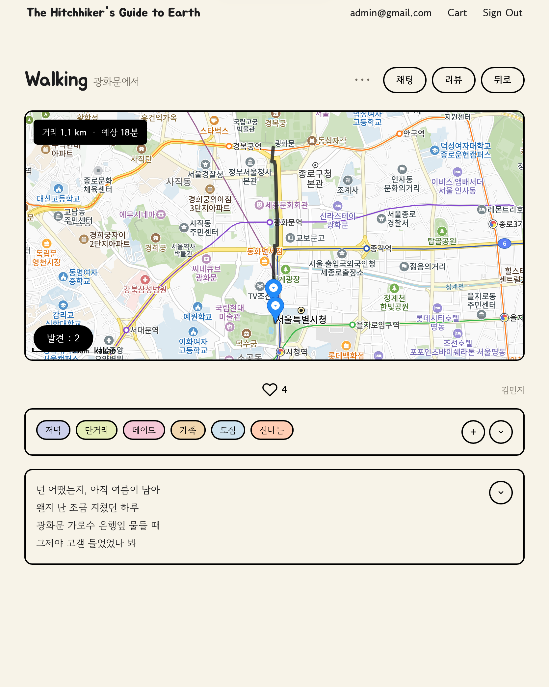
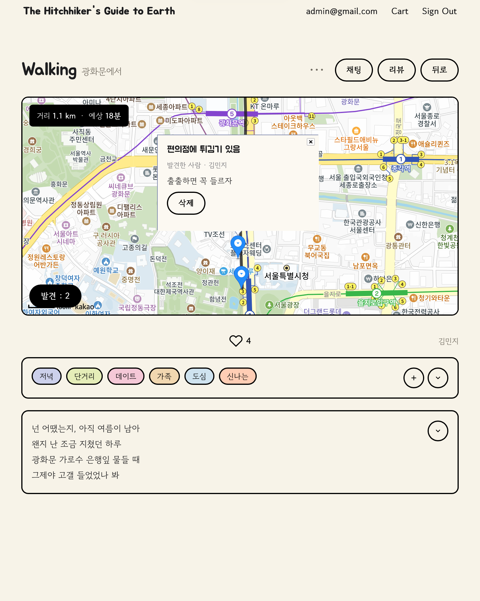
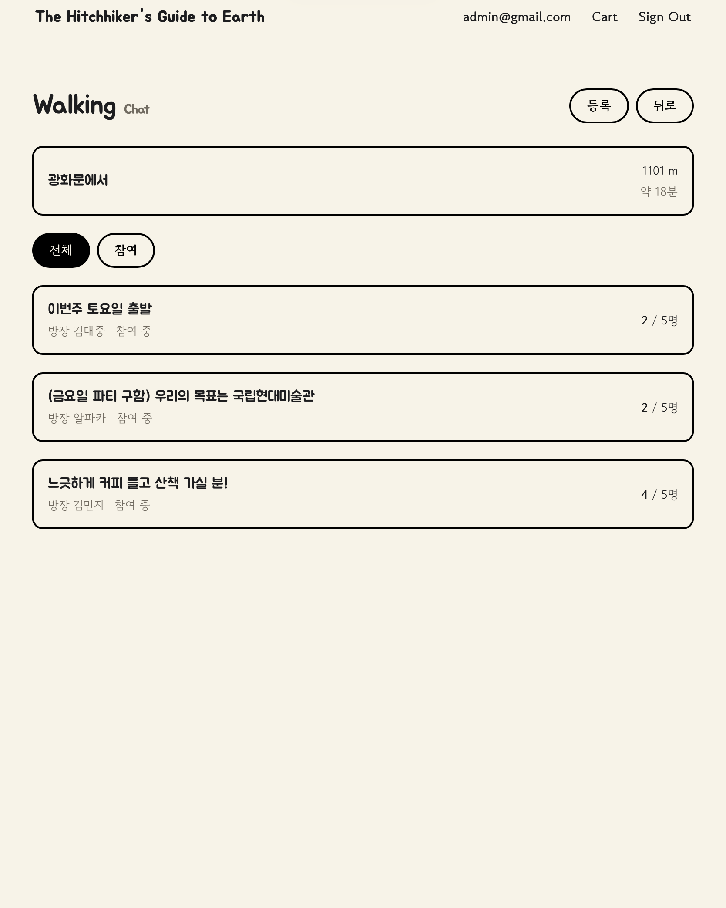
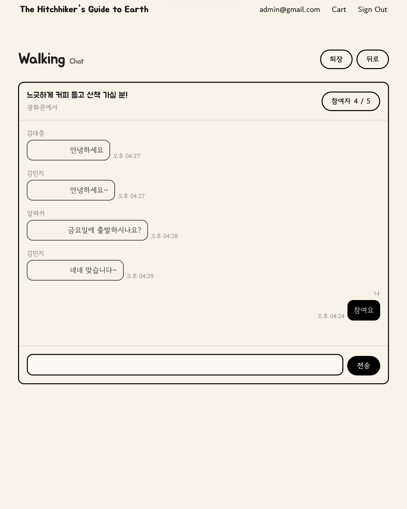
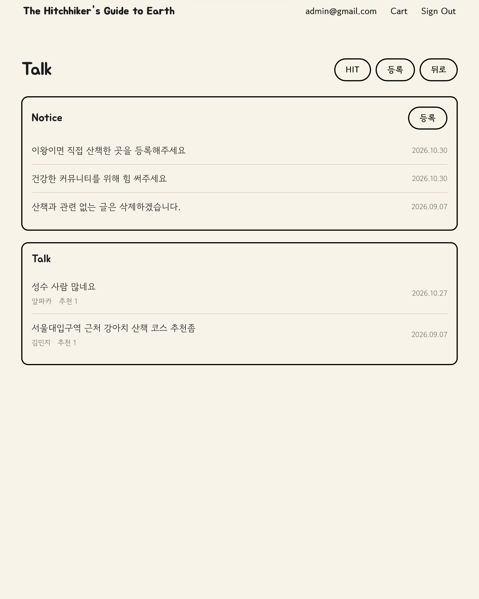
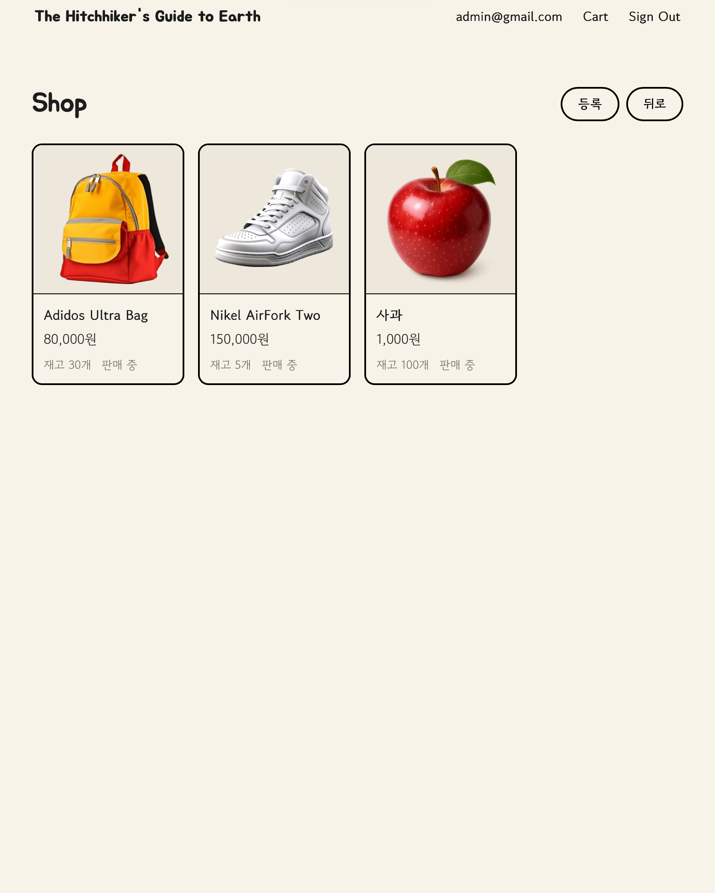
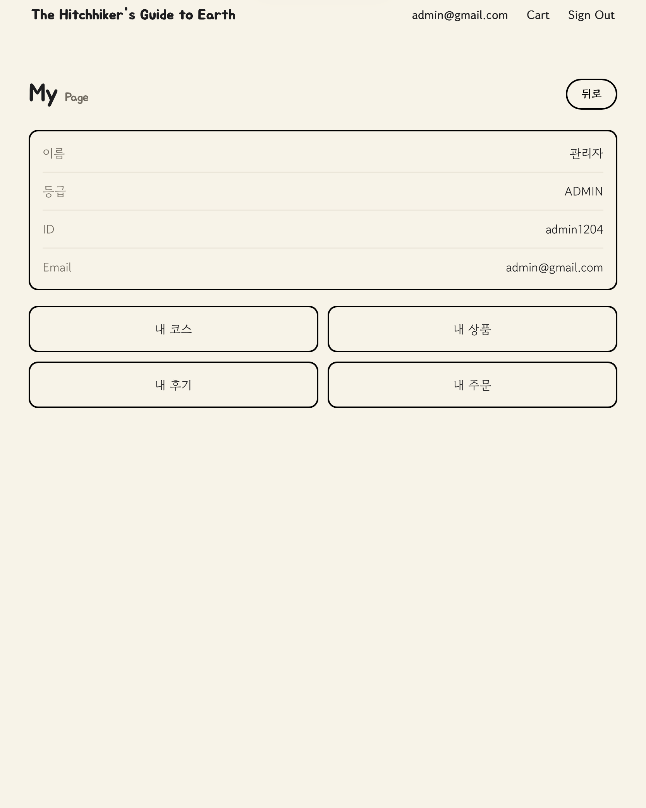

# The Hitchhiker's Guide to Earth

### 산책 경로 공유 서비스

사용자가 원하는 위치를 기준으로 주변 산책 경로를 탐색하고 공유할 수 있는 웹 서비스입니다.

산책 경로를 따라 발견한 장소와 요소를 메모하고, 다른 이용자들과 후기 및 경험을 공유할 수 있습니다.

실시간 채팅을 통한 함께 걷기, 커뮤니티, 중고 거래 기능을 제공하여 사용자 간 소통을 지원합니다.

## 🔗 접속 주소

**[https://decfour.dev](https://decfour.dev)**

**테스트 계정**
- ID: `test`
- PASSWORD: `1234`

---

## 📋 프로젝트 개요

| 항목 | 내용 |
|---|---|
| 개발 인원 | 개인 프로젝트 (1명) |
| 개발 기간 | 2026.07 ~ 2026.10 |

---

## 🚀 주요 기능

- **사용자 인증:** JWT 및 Spring Security 기반 로그인 및 인증
- **산책 경로 공유:** 경로 등록, 수정, 추천 및 위치 기반 주변 경로 탐색
- **산책 경로 발견:** 실제 경로 주변에 발견한 장소나 요소를 메모하고 다른 사용자와 공유
- **산책 경로 리뷰:** 산책 경로에 대한 후기 작성 및 조회
- **함께 걷기:** 채팅방 생성 및 WebSocket / STOMP 기반 실시간 채팅
- **상점:** 사용자 간 중고 거래, 상품 관리 및 주문 기능
- **커뮤니티:** 게시글, 공지사항과 댓글을 통한 사용자 간 소통
- **마이페이지:** 사용자 정보 및 활동 관리

---

## 🛠️ 기술 스택

### Backend


### Database


### Frontend


### Infra & Build


### Communication & API


---

## 🏗️ 시스템 아키텍처



- **AWS EC2:** Spring Boot 애플리케이션 및 MySQL 운영
- **Nginx:** HTTPS 요청 처리 및 Spring Boot 애플리케이션으로의 리버스 프록시
- **Spring Boot:** 비즈니스 로직, 인증 및 WebSocket 기반 실시간 채팅 처리
- **MySQL:** 회원, 산책 경로, 상품, 주문 및 커뮤니티 데이터 관리
- **Local File Storage:** 서비스에서 사용하는 업로드 이미지 저장
- **Kakao Map API:** 지도 표시 및 위치 기반 산책 경로 제공
- **GitHub Actions:** 배포 자동화

---

## 🔧 Troubleshooting & Technical Decisions

### 1. 주변 산책 코스 조회 성능 개선

**문제**

- 사용자 위치를 기준으로 반경 1km 이내의 산책 코스를 조회하는 기능 구현
- 기존 방식은 전체 산책 코스에 대해 거리 계산을 수행하므로 데이터 증가 시 조회 비용이 커지는 구조
- 10,000개의 코스 데이터와 최대 500 VU 환경에서 부하 테스트 수행
- P95 응답 시간이 15.09초까지 증가했으며, 실행 계획에서 Full Table Scan 확인

**원인 분석**

- `ST_Distance_Sphere`를 이용한 거리 계산을 전체 데이터에 수행
- 거리 계산 전에 검색 대상을 충분히 제한하지 못하여 불필요한 데이터 탐색 발생
- 데이터 증가에 따라 거리 계산 대상과 조회 비용이 함께 증가하는 문제 확인

**해결**

거리 계산 자체보다 계산 대상이 되는 후보 데이터를 줄이는 것이 우선이라고 판단

- 위도와 경도에 Bounding Box를 적용하여 후보 산책 코스를 1차 필터링
- `start_lat`, `start_lng` 컬럼에 B-Tree 인덱스를 적용하여 범위 검색 개선
- 1차 필터링 이후 `ST_Distance_Sphere`를 적용하여 실제 반경 1km 이내 여부 검증
- SQL 실행 계획을 비교하여 인덱스 적용 효과 확인

**결과**

| 측정 항목 | 개선 전 | 개선 후 |
|---|---:|---:|
| P95 응답 시간 | 15.09초 | 98.6ms |
| 평균 응답 시간 | 6.01초 | 39.68ms |
| 실행 계획 예상 탐색 행 | 9,792개 | 675개 |

- P95 응답 시간 **약 99.3% 감소**
- 평균 응답 시간 6.01초에서 39.68ms로 개선
- 실행 계획의 예상 탐색 행 9,792개에서 675개로 감소

### 2. WebSocket/STOMP와 HTTP API의 역할 분리를 통한 실시간 채팅 설계

**설계 과제**

- 여러 사용자가 동일 채팅방에서 메시지를 실시간으로 주고받는 기능 필요
- 실시간 메시지 전달뿐 아니라 채팅방 목록과 이전 대화 조회 기능도 함께 제공해야 함
- 메시지 송수신과 이력 조회의 서로 다른 통신 특성을 고려할 필요

**기술적 판단**

실시간 메시지 송수신에는 지속적인 양방향 통신이 필요하지만, 채팅방 목록과 이전 대화는 요청에 따라 데이터를 조회하는 방식이 적합하다고 판단

이에 따라 실시간 전달과 저장된 데이터 조회의 역할을 분리

- **WebSocket:** 지속적인 양방향 통신이 필요한 메시지 송수신에 사용
- **STOMP:** 채팅방별 발행 및 구독 경로를 통해 해당 방 구독자에게 메시지 전달
- **HTTP:** 채팅방 목록은 서버 렌더링으로 제공하고 이전 메시지는 별도 API로 조회
- **Cursor Pagination:** 메시지 ID를 기준으로 이전 대화 조회

**구현**

- STOMP의 채팅방별 구독 경로를 통해 메시지 송수신
- 최초 채팅방 진입 시 최신 메시지 30개 조회
- 이후 현재 조회한 메시지 중 가장 오래된 ID를 `before` 파라미터로 전달
- 해당 ID보다 이전에 작성된 메시지를 추가 조회하도록 구현

**결과**

- STOMP 기반 채팅방별 실시간 메시지 송수신 기능 구현
- HTTP 기반 채팅방 목록 화면 및 과거 메시지 조회 API 구현
- `before` 커서를 활용한 이전 메시지 페이징 구현
- 실시간 메시지 전달과 과거 데이터 조회의 책임 분리

### 3. 동시 주문 시 발생한 Lost Update 해결 및 재고 정합성 보장

**문제**

- 사용자 간 중고 거래를 위한 상점 기능 구현
- 다수 사용자가 동일 상품을 동시에 주문할 때 일부 재고 차감이 누락되는 현상 발견
- 동시 주문 테스트 100건 중 67건만 재고에 반영되는 문제 확인

**원인 분석**

- 여러 트랜잭션이 동일한 상품의 재고를 조회한 뒤 각각 갱신
- 앞선 트랜잭션의 변경 사항이 다른 트랜잭션의 갱신으로 덮어써지는 Lost Update 발생
- 동시 주문 상황에서 재고 데이터의 정합성을 보장하기 위한 동시성 제어 필요

**해결**

재고는 주문 성공 여부와 직접 연결되므로 처리 속도보다 데이터 정합성을 우선

충돌이 빈번하게 발생할 것으로 예상되는 상품 주문에서 낙관적 락의 재시도 비용을 고려하여 비관적 쓰기 락을 선택

- JPA의 `PESSIMISTIC_WRITE` 적용
- 상품 데이터 조회 시점부터 동시 수정 제어
- 동일 상품에 대한 재고 갱신 작업의 충돌 방지
- 트랜잭션의 무한 대기를 방지하기 위해 락 타임아웃 설정

**결과**

100명의 가상 회원, 단일 상품 재고 100개, 32개 스레드 환경에서 동시 주문 테스트를 수행

| 검증 항목 | 결과 |
|---|---|
| 가상 회원 수 | 100명 |
| 초기 재고 | 100개 |
| 동시 주문 요청 | 100건 |
| 테스트 스레드 | 32개 |
| 주문 처리 후 재고 | 0개 |
| 주문 내역 | 회원별 1건씩 정상 생성 |

- 100건의 주문 이후 최종 재고 0개 확인
- 각 회원별 주문 내역 1건씩 정상 생성 확인
- 동시 주문 환경에서 재고 차감 및 주문 데이터 정합성 검증

### 4. JPA N+1 문제 해결

**문제**

- 게시글 상세 화면에서 댓글과 작성자 정보를 함께 조회하는 기능 구현
- 댓글 목록 조회 후 작성자 정보에 접근하면서 추가 SELECT 쿼리가 반복적으로 발생
- 댓글 수가 증가할수록 Member 조회 쿼리도 증가하는 N+1 문제 확인

**원인 분석**

- 댓글 목록 조회 시 댓글과 연관된 작성자 정보를 별도로 조회
- 댓글별 작성자 정보에 접근하면서 반복적인 추가 SQL 실행
- 댓글이 증가할수록 연관 엔티티 조회 비용이 함께 증가

**해결**

댓글 목록과 작성자 정보가 동일 화면에서 함께 필요한 데이터라는 점을 고려

모든 연관관계의 로딩 방식을 변경하기보다 필요한 조회에만 Fetch Join을 적용하는 방식을 선택

- 댓글 조회 시 작성자 정보를 Fetch Join으로 함께 조회
- 댓글별 Member 조회를 하나의 JOIN 조회로 통합
- 전체 연관관계의 로딩 전략을 변경하지 않고 해당 조회만 최적화
- 기존 댓글 페이징 기능 유지

**결과**

- 댓글 조회 시 반복적으로 발생하던 Member 조회 쿼리 제거
- 댓글과 작성자 정보를 JOIN으로 조회하도록 개선
- 기존 댓글 페이징 기능 유지

---

## 🖥️ 주요 화면

### 1. 산책 경로

**주변 산책 경로 탐색**



현재 위치 또는 사용자가 지정한 위치를 기준으로 주변 산책 경로를 탐색할 수 있습니다.

**산책 경로 안내**



주변 산책 경로 목록에서 코스를 선택하면 지도에 해당 경로가 표시됩니다.

**산책 경로 상세**



산책 경로에 대한 설명, 추천, 태그 및 리뷰 기능을 제공합니다.

**산책 경로 발견**



실제 산책 경로의 좌표를 기준으로 주변에 발견한 장소나 요소를 메모하여 다른 이용자와 공유할 수 있습니다.

지도에 표시된 발견 핀을 선택하면 다른 이용자가 남긴 메모를 확인할 수 있습니다.

### 2. 함께 걷기

**채팅방 목록**



함께 산책할 이용자를 모집하기 위해 채팅방을 생성하고 참여할 수 있습니다.

**실시간 채팅**



참여자 간 실시간 메시지를 주고받을 수 있습니다.

- 채팅방 최대 인원: 5명
- 방장이 퇴장하면 채팅방 종료

### 3. 커뮤니티



게시글과 댓글, 추천을 통해 사용자 간 정보를 공유하고 소통할 수 있습니다.

추천 수가 20개 이상인 게시글은 HIT 게시판에서 조회할 수 있습니다.

### 4. 상점

**상품 목록**



사용자가 상품을 등록하고 조회하여 중고 거래를 진행할 수 있습니다.

**상품 상세**


상품을 즉시 구매하거나 장바구니에 담아 주문할 수 있습니다.

### 5. 마이페이지



사용자가 등록한 산책 경로, 상품, 리뷰 및 주문 내역 등 개인 활동을 조회할 수 있습니다.

---

## 📂 프로젝트 구조

```text
src
├── main
│   ├── java/com/kdj/commerce
│   │   ├── config
│   │   ├── domain
│   │   │   ├── cart
│   │   │   ├── chat
│   │   │   ├── community
│   │   │   ├── item
│   │   │   ├── member
│   │   │   ├── notice
│   │   │   ├── purchase
│   │   │   ├── review
│   │   │   └── walk
│   │   ├── exception
│   │   ├── service
│   │   └── web
│   │       ├── argumentresolver
│   │       ├── controller
│   │       ├── dto
│   │       ├── file
│   │       └── security
│   └── resources
│       ├── static
│       │   ├── css
│       │   ├── images
│       │   │   ├── branding
│       │   │   └── icons
│       │   └── js
│       └── templates
│           ├── cart
│           ├── chat
│           ├── common
│           ├── community
│           ├── error
│           ├── member
│           ├── notice
│           ├── purchase
│           ├── review
│           ├── shop
│           └── walk
│               └── review
└── test
    └── java/com/kdj/commerce
        ├── domain
        │   └── purchase
        ├── exception
        ├── service
        └── web
            └── controller
```

---

## 📚 프로젝트 문서

### API 명세서

**[API 명세서 (공개용)](doc/API_SPEC_PUBLIC.md)**

- 주요 HTTP API 및 WebSocket/STOMP 엔드포인트 정리
- 기능별 요청 파라미터 및 응답 동작 명세
- JWT 기반 인증 방식 및 사용자 권한 정리
- 페이징 방식 및 주요 예외 응답 정리