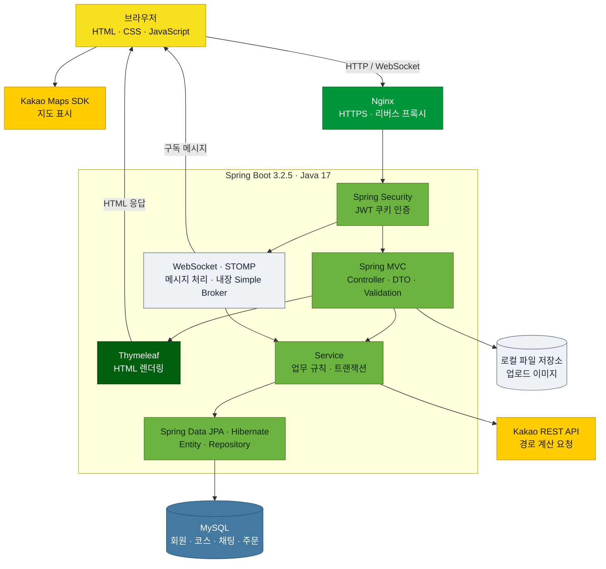
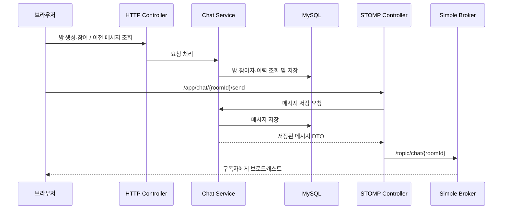

# 프로젝트 아키텍처

> The Hitchhiker's Guide to Earth · 코드 확인 기준: 2026-11-06

산책 경로 공유를 중심으로 채팅, 커뮤니티, 상점·주문을 제공하는 **Spring Boot 단일 애플리케이션**입니다. 
Thymeleaf로 화면을 렌더링하고, 지도·별점·핀은 JSON API로, 실시간 대화는 WebSocket/STOMP로 처리합니다.

## 구조



## 주요 기술과 역할

| 영역 | 기술 | 현재 역할 |
|---|---|---|
| 실행·빌드 | Java 17, Spring Boot 3.2.5, Gradle | 단일 서버 애플리케이션 빌드·실행 |
| 웹 | Spring MVC, Thymeleaf, JavaScript | 서버 렌더링 화면과 일부 JSON API |
| 인증 | Spring Security, JJWT 0.11.5, BCrypt | JWT 쿠키 인증, 비밀번호 해시 |
| 저장 | Spring Data JPA, Hibernate, MySQL | 엔티티 영속화, 쿼리, 트랜잭션 |
| 실시간 | Spring WebSocket, STOMP | 채팅 전송·구독, 애플리케이션 내부 메시지 브로커 |
| 지도·경로 | Kakao Maps SDK, Spring RestClient | 브라우저 지도 표시, 서버의 외부 경로 요청 |
| 파일 | Multipart, 로컬 파일 시스템 | 상품 이미지 업로드·조회 |
| 검증·운영 | Bean Validation, Actuator, JUnit 5, k6 | 입력 검증, 상태·메트릭, 자동 테스트·부하 테스트 |

## 코드 구조

```text
src/main/java/com/kdj/commerce/
├── config/             Security · MVC · WebSocket 설정
├── web/
│   ├── controller/     HTTP 및 STOMP 진입점
│   ├── dto/            폼 · JSON 요청/응답
│   ├── security/       JWT 생성·검증 및 인증 필터
│   ├── argumentresolver/  @Login 회원 주입
│   └── file/           업로드 파일 저장
├── service/            업무 처리 · 트랜잭션 · 외부 API 연동
├── domain/             기능별 Entity · Repository
└── exception/          업무 예외 · 공통 오류 응답

src/main/resources/
├── templates/          Thymeleaf 화면
├── static/             CSS · JavaScript · 정적 이미지
└── application*.properties  공통 · local · prod 설정

src/test/               자동 테스트
k6/                     부하 테스트
scripts/sql/            수동 데이터 보정 SQL
doc/                    API · 예외 처리 · ERD 문서
```

기본 의존 흐름은 **Controller → Service → Repository → MySQL**입니다. 
엔티티와 Repository는 `domain`의 기능별 패키지에 함께 있으며, Service가 트랜잭션을 묶습니다. 
화면은 모델과 템플릿으로, JSON API는 DTO나 `ResponseEntity`로 응답합니다.

## 기능별 경계

| 기능 | 주요 도메인 | 담당 범위 |
|---|---|---|
| 회원 | `member` | 가입·로그인, 회원 조회, 마이페이지의 사용자 기준 |
| 산책 | `walk` | 코스·경로 좌표, 주변 검색, 별점, 태그, 발견 장소 핀 |
| 후기 | `review` | 코스 후기와 상품 후기 |
| 함께 걷기 | `chat` | 채팅방, 참여자, 메시지 이력 |
| 커뮤니티 | `community`, `notice` | 게시글·추천·댓글·공지 |
| 상점 | `item`, `cart`, `purchase` | 상품, 장바구니, 주문·재고·취소 |

마이페이지는 `MyController`와 관련 Service가 각 도메인의 사용자 활동을 모아 보여줍니다. 모든 기능은 같은 애플리케이션과 DB를 사용합니다.

## 핵심 처리 흐름

### 인증과 일반 요청

1. 로그인 성공 시 이메일을 식별자로 JWT를 만들고 `Authorization`이라는 **HttpOnly 쿠키**에 저장합니다. 쿠키와 기본 토큰 유효기간은 30분입니다.
2. `JwtAuthenticationFilter`가 쿠키를 검증해 `SecurityContext`에 인증 정보를 넣습니다. 서버 세션은 사용하지 않습니다.
3. `SecurityConfig`가 경로 접근을 검사하고, `@Login` 인자 리졸버가 이메일로 회원을 조회해 Controller에 주입합니다.
4. 작성자·관리자 여부는 Controller 또는 Service에서 추가 검사합니다. 보호 경로의 미인증 요청은 로그인 화면으로 리다이렉트합니다.

공통 예외 처리는 `GlobalExceptionHandler`가 담당합니다. 
JSON API 또는 명시적인 JSON Accept 요청에는 상태 코드와 오류 JSON을, 일반 화면에는 오류 HTML을 반환합니다. 
Controller에서 직접 처리하는 폼 오류·리다이렉트는 해당 흐름을 따릅니다.

### 산책 검색과 별점

- **주변 검색:** 출발 좌표의 바운딩 박스로 후보를 줄이고, MySQL 거리 함수로 1km 이내를 걸러 거리순으로 페이징합니다.
- **인기 코스:** 평균 별점 → 평가 수 → 생성일 → ID 내림차순으로 상위 30개를 선정한 뒤 화면 단위로 페이징합니다.
- **별점:** 코스에 비관적 쓰기 잠금을 걸고 회원별 평가와 평가 수를 같은 트랜잭션에서 변경합니다. 평균 별점은 Hibernate `@Formula`로 조회 시 계산합니다.
- **경로 계산:** `WalkCourseController → WalkCourseService → KakaoRouteService`가 외부 API를 호출해 좌표 배열·거리·시간으로 변환합니다. 그림의 외부 경로 연결은 현재 코드의 호출 구조를 뜻하며 외부 서비스의 응답 성공 여부를 검증한 것은 아닙니다.

### 채팅



연결 주소는 `/ws/chat`이며 HTTP 핸드셰이크의 JWT 쿠키 인증을 사용합니다. 
이력은 DB에 저장하고 메시지 전달은 프로세스 내부 Simple Broker가 담당합니다. 
방 참여·퇴장은 방 잠금으로 정원을 관리합니다. 
현재 방 화면의 입장 검사와 달리 메시지 이력·STOMP 전송·구독에는 별도 참여 권한 검증이 없습니다.

### 주문과 이미지

- 주문은 `PurchaseService`가 상품 잠금과 트랜잭션으로 재고 변경을 처리합니다. 취소는 주문자 확인 후 재고를 복원합니다.
- 상품 이미지 파일은 `FileStore`가 `file.dir` 아래 저장하고 `/images/{fileName}`으로 제공합니다. DB에는 상품과 이미지 파일 정보가 저장됩니다.

## 실행·운영 설정

| 항목 | 현재 저장소 기준 |
|---|---|
| 기본 프로필 | `local` |
| DB | local·prod 모두 MySQL, 환경변수로 계정 주입 |
| 스키마 | local·prod 모두 `ddl-auto=update` |
| 파일 | local은 `C:/upload/`, prod는 `UPLOAD_DIR` |
| 업로드 제한 | 파일당 5MB, 요청당 5MB |
| 비밀값 | `DB_USERNAME`, `DB_PASSWORD`, `JWT_SECRET`, `KAKAO_REST_API_KEY` |

## 관련 문서

- [API 명세서](API_SPEC_PUBLIC.md): 경로·입력·응답·권한
- [예외 처리 기준](EXCEPTION_HANDLING.md): 오류 응답 정책
- [산책·채팅 ERD](erd/course.md): 데이터 관계
- [테스트 안내](TESTING.md): 검증 방법