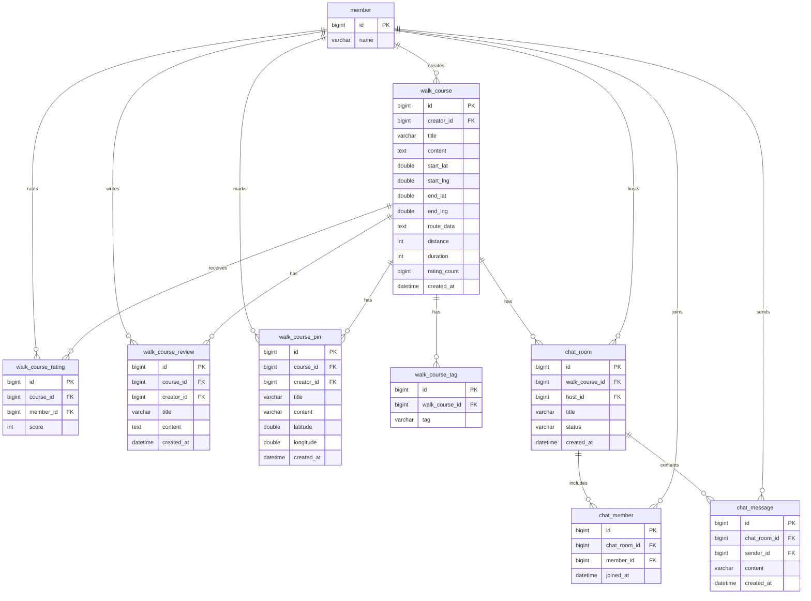

# 산책·채팅 데이터 구조

현재 JPA 엔티티 기준 구조입니다. 회원은 산책·채팅에서 참조하는 필드만 표시합니다.

- 별점은 `1~5`의 정수이며 `(course_id, member_id)` 조합은 유일합니다.
- `rating_count`는 저장된 평가 수입니다. 최초 평가·취소 시 코스를 잠그고 별점과 같은 트랜잭션으로 갱신합니다.
- 평균 평점은 저장 칼럼이 없으며 Hibernate `@Formula`로 조회 시 계산합니다.
- 리뷰와 별점은 독립적입니다. 리뷰 상세는 작성자의 현재 별점을 조회합니다.
- 코스 삭제 시 태그·평가·리뷰·핀은 엔티티의 삭제 전파 대상으로 처리합니다.
- 채팅 참여의 `(chat_room_id, member_id)` 조합은 유일합니다.
