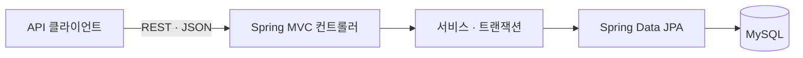

# FoodLab

> Optimize everything. Including dinner.

FoodLab은 **적은 비용으로 영양 균형을 갖춘 한 끼를 만드는 것**을 목표로 하는 온라인 요리 연구소다. 자신만의 요리를 실험 보고서로 공유하고, 다른 연구원의 요리를 따라 만들어 보며 조리 편의성·맛·경제성을 평가할 수 있다.

쇼핑 API를 연동해 요리에 필요한 재료별 상품과 가격을 비교하고, **검색 결과에서 가장 저렴한 구매 옵션**을 찾을 수 있도록 할 예정이다.

## 🚀 주요 기능

- **연구원 인증** · 회원가입, 로그인·로그아웃, JWT 액세스 토큰 발급과 리프레시 토큰 갱신
- **실험 보고서** · 요리 등록·수정·삭제, 이름 검색, 최신순·평가순 정렬, 페이지네이션
- **실험 재료** · 공통 재료 재사용, 요리별 수량과 단위 저장, 상세 조회에서 재료 목록 제공
- **동료 검증** · 조리 편의성·맛·경제성을 각각 1~5점으로 평가하고, 항목별 평균과 종합 효율 지수 제공
- **연구원 활동** · 내 정보 조회·수정, 내가 등록한 요리와 작성한 평가 조회

요리와 평가는 누구나 조회할 수 있다. 수정·삭제는 작성자에게만 허용하며, 회원은 다른 연구원의 요리에 한 건씩 평가할 수 있다.

## 🛠️ 기술 스택


| 구분 | 기술 |
| --- | --- |
| 백엔드 | Spring Web MVC, Spring Data JPA, Hibernate |
| 인증 | Spring Security, JWT, BCrypt |
| 검증 | JUnit 5, MockMvc, MySQL 통합 테스트 |
| 개발 도구 | OpenAI Codex로 API 설계, 코드 구현, 테스트 작성 |
| 프론트엔드 예정 | React, Vite |

## 🏗️ 시스템 아키텍처



- `material`에는 양파·고구마 같은 공통 재료를 저장한다. `food_material`에는 요리별 사용량과 단위를 저장하며, `소금 약간`처럼 수량이 없는 재료도 표현할 수 있다.
- 액세스 JWT는 15분 동안 유효한다. 리프레시 토큰은 HttpOnly 쿠키로 전달하고 DB에 해시를 저장한다. 갱신 시 기존 토큰을 교체한다.
- 개발 환경은 Hibernate로 스키마를 관리한다. 테이블 설계가 확정되면 Flyway 초기 V1을 작성할 예정이다.

## 📂 프로젝트 구조

```text
src/
├── main/
│   ├── java/com/kdj/food/
│   │   ├── auth/          # 인증 컨트롤러·서비스·토큰 저장소
│   │   ├── common/        # 공통 응답·예외·시간 매핑
│   │   ├── config/        # Security·JWT 설정
│   │   ├── controller/    # 회원·요리·평가 API
│   │   ├── service/       # 비즈니스 규칙
│   │   ├── repository/    # 영속성·조회
│   │   ├── entity/        # JPA 엔티티
│   │   └── dto/           # API 데이터
│   └── resources/         # 애플리케이션·개발 프로필 설정
└── test/                  # API 및 MySQL 통합 테스트
doc/
├── prd.md
├── api.md
└── schema/               # 테이블별 MySQL DDL
```

## 📌 개발 예정

- 재료 자동완성, 보유 재료 조합 검색, 부족한 재료 안내
- 조리 단계와 이미지 업로드
- 쇼핑 API 기반 재료별 상품 검색 및 조회 결과 내 최저가 비교
- React 화면 연동과 배포

## 📚 프로젝트 문서

- [기획서](doc/prd.md)
- [API 명세서](doc/api.md)
- [AI 개발 로그](doc/ai-log.md)
- [트러블슈팅](doc/troubleshooting.md)
